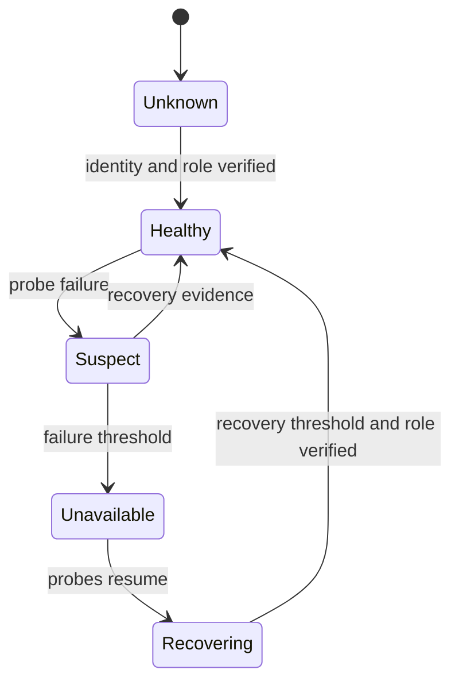

# Cluster management

Configured backend registration is the initial discovery mechanism. Each entry names a stable ID, cluster, endpoint, expected role, TLS server name, weight, and optional infrastructure identity used by fencing. DNS changes alone do not establish cluster membership. Validate system identity before admitting a new backend.

## Health and topology

Use authenticated SQL probes, with TCP checks as a preliminary transport signal. Role, availability, lag, maintenance and eligibility are separate fields. Suggested lab values are 2 second probe period, 1 second probe timeout, 3 failed probes to mark suspect/unavailable, 3 successful probes for recovery, and 6 second observation expiry. They are proposals for fault injection testing, not production promises. Immediately exclude a confirmed role mismatch from new acquisition even before generic failure hysteresis completes.

The diagram describes observations. A node can stay healthy throughout a drain and after detach. A successful probe cannot clear an operator's maintenance, detach or quarantine decision. Admission checks observation expiry on the local monotonic clock even if the probe publisher stalls. An unexpected role change also revokes affected leases under the [routing contract](sql-routing.md).

Drain stops new acquisitions and exposes the remaining leases. The [data plane](data-plane.md) owns the deadline and visible closure of remaining sockets. Attach requires an explicit operation and fresh identity, role and replication evidence. Quarantine survives restart under the [control plane contract](control-plane.md).

## Replication freshness

Compare LSNs only for compatible system identity and timeline history. Distinguish sent, write, flush, receive and replay positions. A stopped workload can make last transaction replay timestamps misleading, so time since replay is not a complete lag measure. Use source freshness and byte lag, show unknown values explicitly, and exclude replicas when necessary evidence is missing. Provisional read eligibility is at most 16 MiB replay lag with fresh samples, subject to workload review; it is not a causal consistency guarantee.

## Selection policies

Weighted round robin among eligible replicas is the first policy. Least active leases is a sensible next experiment; least latency is later because feedback can oscillate. Replica priority, database/user affinity, admission-time lag filtering and draining are policy inputs. Primary fallback for replica profiles is disabled in V1. Do not change endpoint mid lease. Compare behavior with Pgpool's weights and session versus statement load balance options without claiming configuration compatibility.
