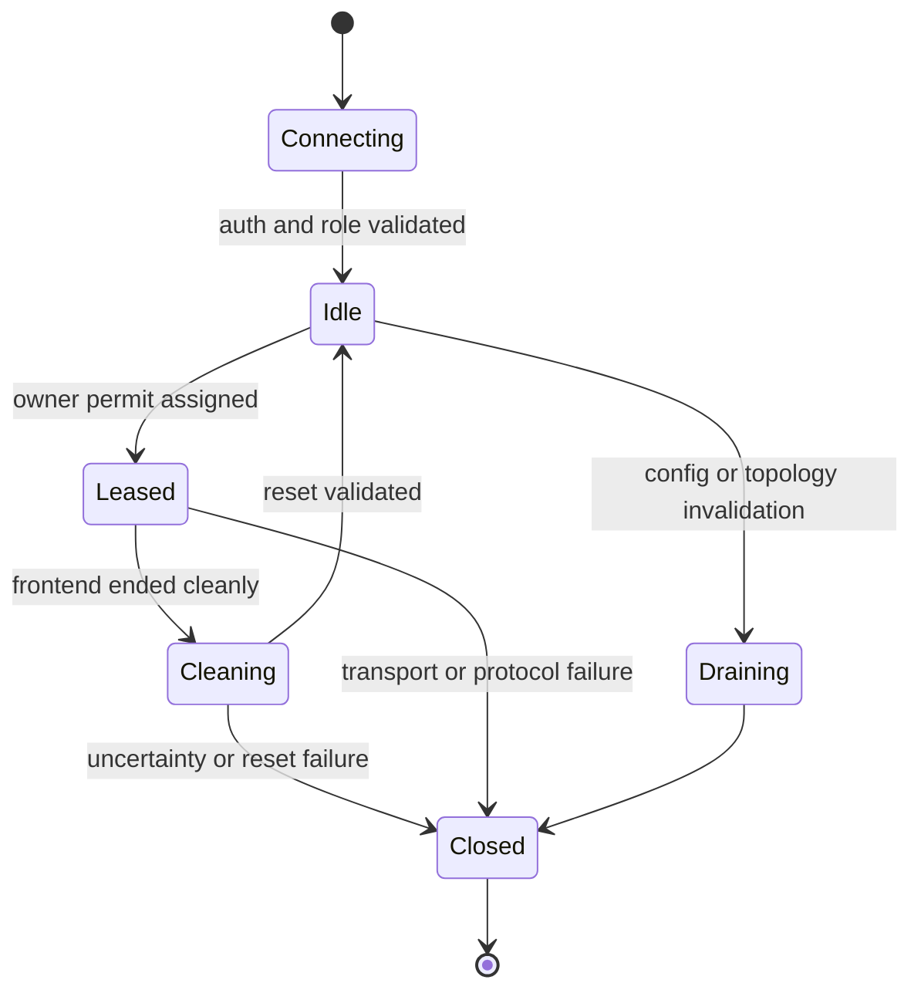

# Connection pooling

Session pooling is the initial mode. One frontend owns one backend lease for its lifetime. Disconnected frontend sessions may leave a reusable clean backend; simultaneously connected sessions do not share it. This preserves compatibility while providing less backend reduction than transaction multiplexing.

## Pool identity and lifecycle

The pool key includes cluster ID, actual backend login identity, database, endpoint, protocol/startup profile, TLS identity policy, credential generation and topology epoch. Never merge pools merely because usernames have the same display text in different clusters.

After frontend termination, revoke virtual cancellation credentials and serialize retirement with any cancellation dispatch. V1 closes a physical backend after any forwarded cancellation rather than reusing it while delivery could remain in flight. Consume other outstanding responses only within a bounded cleanup state. Roll back an open or failed transaction when possible, then reset known state outside a transaction and require idle ReadyForQuery. `DISCARD ALL` helps reset documented PostgreSQL session resources but is not a universal guarantee for extension state. Close sessions with unknown state, active COPY, uncertain protocol synchronization, or failed cleanup.

## Limits and operations

Support bounded global, per node, per database and per identity limits; queue deadlines; minimum warm capacity; idle timeout; maximum lifetime; validation; drain; and reserved operational capacity. Reconfiguration removes old generations from new acquisition. Credential rotation drains old idle connections and retires leased ones when released; immediate revocation can explicitly disconnect affected sessions with an audit event.

## Deferred modes

Transaction pooling needs a feature compatibility contract for GUCs, SQL PREPARE versus protocol prepared statements, portals, temp objects, LISTEN, locks, cursors, sequences and extension state. Statement pooling additionally conflicts with explicit transactions and is not planned for V1. Do not implement either as an unnoticed switch in a session pool.
