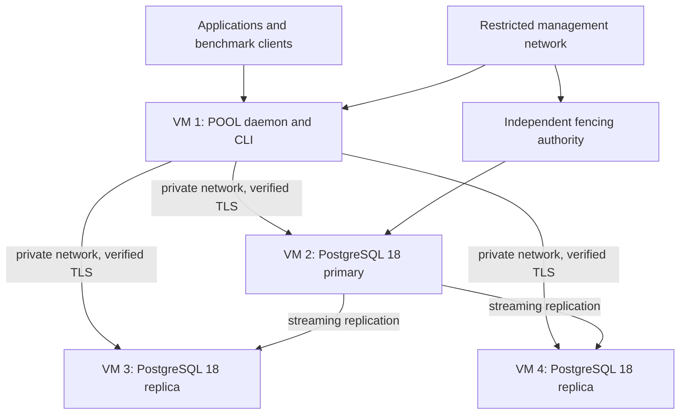

# Deployment reference

## Initial four VM lab

Use a dedicated unprivileged POOL account, restrictive secret files, systemd supervision and limits, a persistent local journal directory, verified backend certificates, and a separate administrative listener. Private networking does not replace encryption or authentication. Do not give the daemon a general Proxmox administrator token.

A provisional benchmark lab can use 4 vCPU and 8 GiB for POOL, 4 vCPU and 16 GiB per database node, and a separate load generator. These are budget assumptions, not sizing advice. Record CPU pinning, NUMA, storage, cache state, network bandwidth, host contention and overcommit. Four VMs on one Proxmox host have a shared host failure domain; replication alone cannot survive that host's loss.

## Future deployment

Two or more proxy VMs can sit behind an external TCP load balancer or explicitly managed virtual IP. Session affinity and cancellation routing need a design: a cancellation connection must reach its token owner or a secure shared dispatch service. A single controller authority coordinates changes through a tested external consensus service. Losing authority must prevent mutations; it must not cause every proxy to elect itself as PostgreSQL promoter.

Keep control leases and topology epochs off the query hot path. Define maximum snapshot age and safe behavior during isolation. Process restarts rebuild observations; proxy client sessions still reconnect. Existing transactions cannot be moved by moving a virtual IP.

## Ownership

| Owner | Responsibility |
|---|---|
| PostgreSQL | Data integrity, WAL, physical/logical replication, backup and recovery primitives |
| POOL | Protocol, leases, routing admission, observations, explicit operation coordination and diagnostics |
| systemd or container supervisor | Process lifecycle, restart limits and resource policy |
| Proxmox and infrastructure operators | VM identity, host placement, network/storage availability and fencing integration |
| External fence provider | Verified exclusion of old writers |
| Operators | RPO/RTO policy, credentials, certificates, backups, upgrade and restore drills |

No infrastructure has been deployed or configured in this planning phase.
