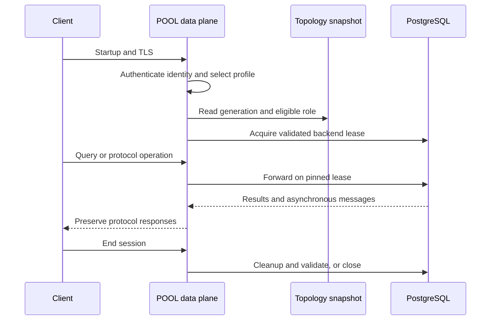

# Architecture overview

The [initial decision](../specs/0001-initial-architecture/index.md) establishes one daemon, a separate CLI, four internal crates, and clearly separated control and data responsibilities. You ratified its content on 2026-11-14. Its lifecycle remains Proposed because the foundation is unbuilt. The [decision ledger](../plan/decision-ledger.md) distinguishes your confirmed choices from remaining planning assumptions.

## Application path

## Module contracts

Protocol produces validated frames and state events. Authentication produces a verified frontend identity; operator configuration maps it and the requested database to permitted backend login, credential reference and profile. Pooling owns permits and backend leases. Initial selection uses profile and fresh topology at login. Later operation admission uses syntax, session state and policy on that pinned lease, without changing endpoint. Control combines durable approved authority with fresh observations; it does not mutate a live session's backend behind its owner.

Proposed public interfaces are `FrameDecoder`, `SessionState`, `Lease`, `RouteDecision`, `TopologySnapshot`, `ProbeObservation`, `OperationPlan`, and `AuditEvent`. A lease has a unique generation so cancellation and delayed completions cannot affect a reused backend. Exact Rust signatures belong to the feature specs, not this conceptual diagram.

## Failure behavior

Loss of the proxy ends its client sessions. Loss of a backend ends affected sessions; POOL does not migrate in flight work. Loss of observation freshness closes new admission for the uncertain role. Administration and metrics have bounded resources so query overload does not consume all diagnostic capacity. A failed journal blocks mutations and promotion planning, while independently safe existing traffic can continue under an explicit observation expiry policy.

There is no claim of transparent failover, no implicit transaction replay, and no benchmark result in this planning package.
