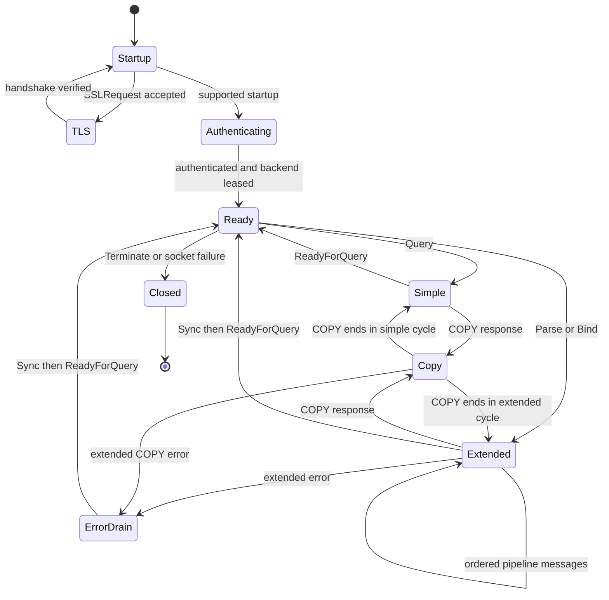

# Protocol engine

The detailed [protocol analysis](../research/protocol-analysis.md) owns the compatibility inventory. The engine should be a finite state machine with typed transitions and bounded frame inspection, independent of administrative code.

Transaction state is tracked separately from the message cycle, using the idle, transaction or failed status in ReadyForQuery. A completed COPY resumes its enclosing cycle. The protocol spec must define the expected response, next state or close action for each supported message, including an early disconnect. The [PostgreSQL 18 message flow](https://www.postgresql.org/docs/18/protocol-flow.html) defines recovery at Sync and the boundary between COPY and the enclosing cycle.

Startup packets have no message tag. Ordinary message lengths include their length field but exclude the tag. Validate minimum lengths, integer overflow, NUL boundaries, field counts and state legality before allocating. Forward bulk payloads without decoding SQL values. Preserve format codes and unknown notice fields. Unsupported protocol paths should fail explicitly, never fall through as normal query data.

The authentication adapter may reuse reviewed pgwire components, but POOL retains control of state, backend truth and advertised parameters. Do not use a server framework's canned `is_superuser`, transaction status, or version values for a proxied backend. First party protocol code uses safe Rust; any native dependency boundary needs a documented exception and fuzz harness.
