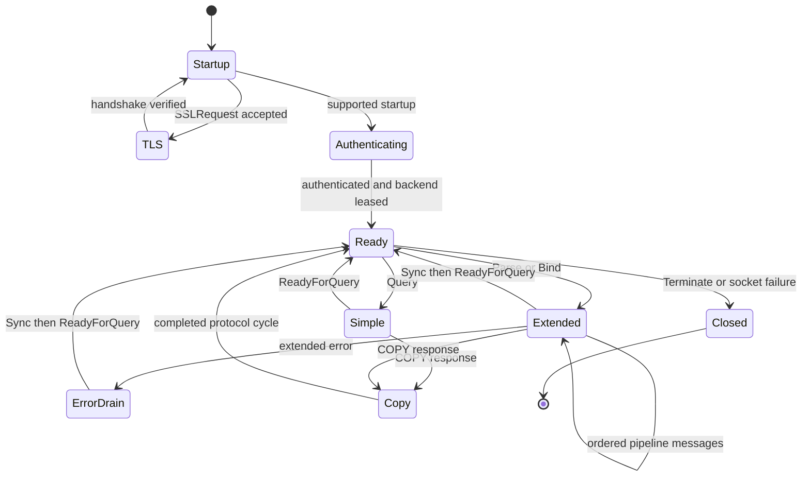

# Protocol engine

The detailed [protocol analysis](../research/protocol-analysis.md) owns the compatibility inventory. The engine should be a finite state machine with typed transitions and bounded frame inspection, independent of administrative code.

This is an overview, not a substitute for the full transition table. COPY may finish within an extended cycle that still needs Sync. Transaction state is orthogonal, taken from ReadyForQuery as idle, transaction, or failed transaction. The implementation spec needs exact transitions for every message in each state, including early disconnects.

Startup packets have no message tag. Ordinary message lengths include their length field but exclude the tag. Validate minimum lengths, integer overflow, NUL boundaries, field counts and state legality before allocating. Forward bulk payloads without decoding SQL values. Preserve format codes and unknown notice fields. Unsupported protocol paths should fail explicitly, never fall through as normal query data.

The authentication adapter may reuse reviewed pgwire components, but POOL retains control of state, backend truth and advertised parameters. Do not use a server framework's canned `is_superuser`, transaction status, or version values for a proxied backend. First party protocol code uses safe Rust; any native dependency boundary needs a documented exception and fuzz harness.
