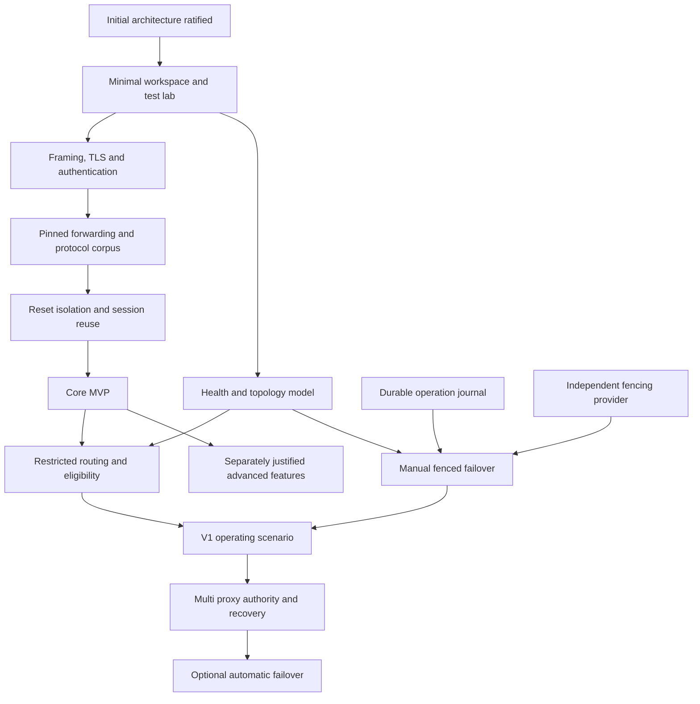

# Dependencies and critical path

Protocol state, authentication identity, cleanup, routing semantics, and promotion safety are the critical path. Tooling, telemetry definitions and lab automation can overlap after interfaces are stable. Do not parallelize conflicting implementations of the same lease or topology authority.

## External prerequisites

You need PostgreSQL 18 primary and physical replicas, verified TLS identities, a restricted monitor role, an actual out of band fencing method, tested backups, and a separate load generator. HA later needs independent failure domains and an operated consensus service or an external cluster manager. None is assumed to exist merely because a Proxmox VM can be created.

## Dependency boundaries

Protocol does not depend on control or administration. Core does not read SQLite. Control does not consume arbitrary frontend query bytes. Administration mutations call the same operation service as CLI actions. Metrics and log exporters cannot block leases or become a source of unbounded queues. [Workspace proposal](../repository-structure.md) records the acyclic crate graph.
