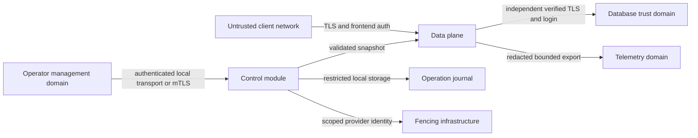

# Threat model

**State:** Design analysis, 2026-11-14. No implementation penetration test or code security audit has run.

## Assets and actors

Protect database contents and acknowledged commits, backend login identity, client/verifier/backend secrets, TLS private keys, cancellation tokens, session state, topology authority, fencing credentials, durable operation history and availability. Actors include application users, malicious network clients, an on path attacker, a compromised application identity, an authorized operator making a mistake, a compromised proxy/control host and a stale or partitioned controller.

The database superuser, host root and infrastructure administrator can bypass POOL's boundaries. They remain trusted but their credentials must be restricted and their actions audited by the surrounding environment. A malicious extension can perform effects outside PostgreSQL transaction rules; parser and read only mode cannot turn it into trusted code.

## Trust boundaries

## Threats and controls

| Threat | Entry and impact | Required control | Verification |
|---|---|---|---|
| Frame confusion or memory exhaustion | Startup/message lengths, endless streams | Checked bounds, state machine, byte/time budgets | Fuzz all states, fragmented inputs and slow clients |
| Password or SCRAM downgrade | Frontend handshake | Reviewed SCRAM, TLS policy, channel binding negotiation and proof length checks | PostgreSQL interoperability and downgrade corpus |
| Backend impersonation | DNS/network/certificate path | CA and hostname verification; identity checked after connection | Wrong hostname, CA, role and system ID tests |
| Role confusion and cross tenant reuse | Pool keys and credential maps | Actual login identity partitioning; no global privileged SET ROLE scheme | Alternating role/database and credential generation tests |
| Late cancellation affects another user | Token map after release/reuse | Private backend keys, virtual frontend credentials, serialized retirement and backend closure after forwarded cancellation | Completion/release/reuse race model |
| Unsafe replica routing | SQL syntax or catalog indirection | Primary default, restricted read profile, trusted object contract and DB permissions | Adversarial function, cast, view, FDW, RLS and session corpus |
| Commit replay duplicates effects | Backend connection loss | No replay after dispatch; expose uncertainty | Drop response after committed write |
| Management privilege escalation | REST/CLI identity or oversized request | Authenticated protected listener, role checks, body/rate limits | Denial matrix and malformed requests |
| Command injection | Fencing/recovery hook arguments | Structured allowlisted adapter, no arbitrary shell endpoint | Adversarial node names and argument tests |
| Split brain or stale leader | Partition, pause, incomplete power action | Independent verified fencing, fresh epoch/preconditions, durable intent | Partitions and crash at every operation stage |
| Journal tampering, loss or disk full | Host/storage boundary | Restrictive files, durable writes, bounded retention, export, fail closed mutations | Power/crash, full disk, corrupt journal drills |
| Secret disclosure through diagnostics | Errors, logs, traces, metrics | Explicit redaction, no raw SQL/parameters by default, bounded label values | Snapshot tests with seeded canary secrets |
| Dependency or native parser compromise | Build and runtime supply chain | Pins, SBOM, notices, advisories, isolated native boundaries | Reviewed update PRs, fuzz/sanitizer runs |
| Correlated host failure | Single Proxmox host | Separate hosts/failure domains before HA claims | Full host loss drill |

## Residual risks

Fencing correctness depends on infrastructure outside the daemon. PostgreSQL permissions and object ownership can change independently. The native parser, crypto provider and SQLite introduce reviewed unsafe/native code despite safe first party Rust. A compromised host can read credentials or alter observations. These require operational controls; do not represent language choice as a complete security boundary.

## Security review boundaries

Parser/framing/authentication changes need a security capable reviewer. Pool/session/cancel changes need protocol and isolation review. Promotion/authority/fencing changes need database and infrastructure review. No automatic security scan result is implied by this document. Review the model whenever a new listener, privilege, credential, native dependency, or distributed authority is introduced.
