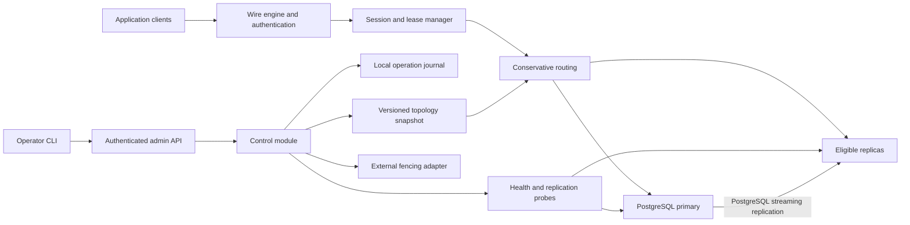
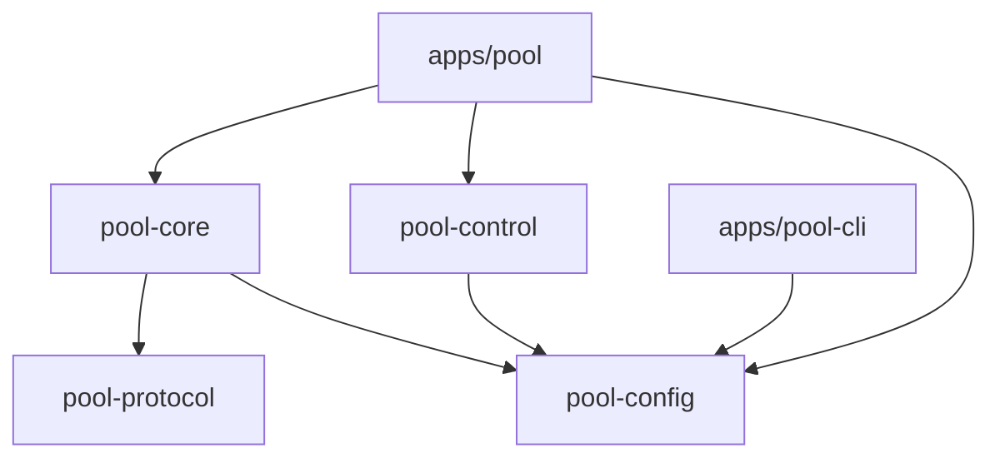

# 0001. POOL initial architecture

**Date**: 2026-11-14
**Status**: Proposed

## Summary

You can start POOL as one Rust daemon with clear data and control modules, plus a separate administration CLI. PostgreSQL remains responsible for storage and replication. Session pooling comes first. Replica routing, promotion, and recovery each need a proven safety contract before you enable them.

## Decision

**Chosen option**: A modular daemon with an independent CLI. The separate controller executable is deferred until multiple proxy instances need a single authority. You ratified this foundation on 2026-11-14 after the independent critique and approved fixes. Implementation is queued. The lifecycle status remains Proposed because its linked buildable scope feature is unbuilt. (basis: your four VM scenario, small operational surface, vertical delivery)

The project is one product in a Cargo workspace, so its scope and specs use `docs/scope/` and `docs/specs/`. The requested research, architecture, PRD, and ADR directories are human reference views. This spec owns the initial architecture decision. Feature PRDs record proposed requirements; later feature specs own implementation decisions.

## Proposed stack

| Layer | Proposed choice | Reason and runner up |
|---|---|---|
| Language | Rust 1.100.0, edition 2024 | Current verified stable release. An older stable MSRV is possible after dependency CI proves it. |
| Runtime | Tokio, bounded tasks and channels | Fits long lived socket workloads. A thread per client is simpler but costly at high idle connection counts. |
| Wire path | An explicit POOL protocol state machine using bytes and tokio::net | Keeps framing and state visible. A PostgreSQL client driver belongs in monitoring, not between arbitrary frontend frames and backends. |
| TLS | rustls and tokio-rustls | Maintained Rust integration. OpenSSL remains an alternative where a required crypto policy demands it. Neither choice implies a fully safe transitive dependency graph. |
| SQL syntax | pg_query 18.1.0 behind an adapter | Uses PostgreSQL grammar. Pure Rust sqlparser is the runner up for a strictly limited subset. Both need server and policy guardrails for semantics. |
| Configuration | Typed Serde structures from TOML | Reviewable configuration with explicit validation and generations. YAML adds complexity without a demonstrated need. |
| Administration | A versioned local REST API and pool-cli | Equivalent operator capabilities without copying PCP initially. Remote administration needs mTLS and role authorization. |
| Durable control operations | A local SQLite journal, one writer | Persist approved writer, epoch, quarantine and operation intent. PostgreSQL probes establish observed role, not authorization. This journal does not establish distributed authority. |
| Metrics and logs | prometheus-client and tracing | Bounded labels and redacted structured events first. OTLP tracing is optional later. |
| Packaging | Linux systemd and OCI images | Fits your VMs and containers. Kubernetes is not required. |
| Future coordination | External etcd, subject to a separate HA decision | Reuse established consensus. An embedded consensus library creates a larger storage and operations obligation. |

Versions, licenses, maintenance signals, limitations, and alternatives are in [technology evaluation](../../research/technology-evaluation.md). Only dependencies needed by a slice would be installed during implementation.

## Boundaries

The data plane reads immutable topology snapshots. It does not perform blocking journal work, call infrastructure APIs, or wait for consensus on each query. The control module publishes snapshots only after validation. A failed role or freshness check removes admission eligibility; it does not trigger promotion.

The initial daemon is a shared process failure domain. A panic, memory exhaustion, or runtime starvation can affect both planes. Bounded probe tasks, dedicated blocking work, timeouts, and process resource limits reduce that risk. Process isolation remains a future extraction option.

## Safety contracts

1. A backend lease belongs to one frontend for its whole session. Transaction and statement multiplexing are deferred.
2. Backend identity includes cluster, database, actual login role, endpoint, TLS policy, startup profile, credential generation, and topology epoch. A reused connection must pass cleanup and validation.
3. An operator configured map resolves verified frontend principal and requested database to allowed cluster, database, actual backend login, credential reference/generation and routing profile. Unmapped combinations fail. Startup strings alone cannot select backend credentials.
4. Primary routing is the default. Read only profiles select an eligible replica at login using fresh role and lag evidence; later SQL is admitted or rejected on that pinned lease. The byte lag threshold is an admission screen, not a continuous staleness bound. Reads are explicitly eventual. Initial replica profiles have no writable primary fallback.
5. A primary profile remains on its primary lease for its lifetime. A replica profile cannot become a write profile mid session. Before controlled promotion, close admission and retire affected replica leases. Clients reconnect to change profiles or recover from backend loss.
6. No statement or transaction is replayed after bytes may have reached a backend. A lost COMMIT response is an uncertain outcome for the application to reconcile. Acquisition can retry only before exposing the initial lease and ReadyForQuery, never to replace an established session's lost backend.
7. Promotion requires an authenticated operator, a specific operation plan, fresh preconditions, and independently verified fencing. Durable intent precedes both provider fencing and promotion. A known final WAL target additionally requires a write barrier across every writer path; otherwise the loss window is unknown and explicitly acknowledged.
8. Bootstrap approved writer identity from configuration once, then persist approved writer, topology epoch and quarantine in SQLite. On restart, reconcile incomplete operations and require fresh compatible PostgreSQL observations before admission. Configuration or observed-role conflicts fail closed rather than silently replacing durable authorization.
9. The session manager issues per lease virtual cancellation credentials and keeps real backend key data private. It revokes mappings before release and serializes cancellation dispatch with retirement. V1 retires a physical backend after any forwarded cancellation, so uncertain delivery cannot reach a later lease. The promise is isolation across leases, not cancellation of one uniquely identified query.
10. A cache, automatic failover, native replication, and snapshot isolation replication are outside the initial release and disabled if configuration names are reserved.

## Repository boundaries

Start with `apps/pool`, `apps/pool-cli`, and four internal crates: `pool-protocol`, `pool-config`, `pool-core`, and `pool-control`. These are a layout proposal, not directories scaffolded in this planning phase.

`pool-protocol` owns framing and protocol types. `pool-config` owns validated configuration types. `pool-core` owns authentication integration, leases, session state, routing, and backend I/O. `pool-control` owns observations, topology, administrative operations, journal, and probe scheduling. Modules are extracted into new crates only when an independent interface, dependency set, or testing boundary justifies it.

Control owns observation DTOs, and core owns routing inputs plus drain/status handles. The daemon maps between those types and adapts bounded commands. Libraries never import types from the application binary, and neither library depends on the other. The CLI uses the public administration contract. There is no initial `common`, cache, consensus, or controller crate.

## Consequences

You get a simpler initial deployment and a smaller dependency graph. You also accept a shared process failure domain, native C parser build requirements, provisioning of independent frontend and backend credentials, and limited replica routing at first. Session pooling reduces reconnect cost and reuses disconnected clients' backends; it does not reduce the number of backends held by simultaneously connected clients.

## Follow-up

1. The assembled foundation and [decision ledger](../../plan/decision-ledger.md) are ratified. Implementation remains queued until you explicitly request it.
2. Deliberate the frontend authentication implementation, bounded routing profiles, durable operation model, and fencing adapter in individual feature specs before those slices are built.
3. Optional Rust, Tokio, PostgreSQL, and operations skill or MCP discovery was deferred by you. Nothing has been searched or installed for that purpose.
4. Apache 2.0 is your chosen project license and the official text is installed. Review each file and transitive component before source reuse.
5. The independent critique completed. Its decision gaps and your resolution are recorded in the decision ledger before final acceptance.

## Rationale

Reasoning, alternatives, and source evidence: [rationale.md](rationale.md).
