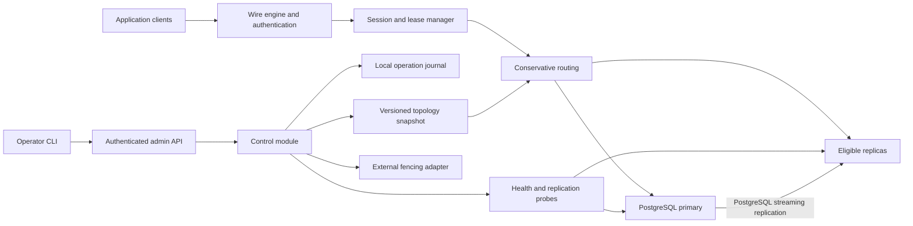
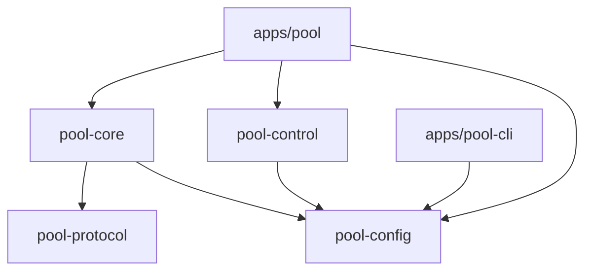

# 0001. POOL initial architecture

**Date**: 2026-11-14
**Status**: Accepted

## Summary

You can start POOL as one Rust daemon with clear data and control modules, plus a separate administration CLI. PostgreSQL remains responsible for storage and replication. Session pooling comes first. Replica routing, promotion, and recovery each need a proven safety contract before you enable them.

The first build ([scope 001](../../scope/001-stack-and-workspace.md)) is small on purpose. It is a workspace with the daemon binary and the configuration crate, and one offline command, `pool check-config`, that accepts or rejects a configuration file. The [workspace build notes](#workspace-build-notes) fix its toolchain, Linux target, dependencies, output and exit status, so the people who build, check and test it work from one text.

## Requirements

These criteria cover the first build only, [scope 001](../../scope/001-stack-and-workspace.md). Cite them as `0001 AC-n`. Later slices keep their criteria in their own specs. Fixture names refer to [Fixtures](#fixtures). Exact output text is under [Exit status and output](#exit-status-and-output) and [Findings](#findings).

**User stories**:

- As an operator, I want to check a configuration file before I start POOL, so that a mistake is found at my desk and not in production.
- As a reviewer, I want unsupported capabilities to be refused by name, so that nobody turns on caching or automatic promotion by editing a file.
- As a maintainer, I want one small real path through the workspace, so that later slices extend a build, a configuration contract and an output contract that already work.

**Acceptance criteria**:

- **AC-1** (workspace and toolchain pin): From a clean checkout, `cargo build --locked --release -p pool` succeeds with Rust 1.100.0 selected by `rust-toolchain.toml`. `cargo metadata --no-deps --format-version 1` lists exactly two workspace members, `pool` and `pool-config`. `Cargo.lock` is committed.
- **AC-2** (Linux build): The command under [Linux build](#linux-build) ends with exit status 0 and the line `linux build check passed`. Its output shows `host: aarch64-unknown-linux-gnu`. It builds only the committed tree. A build on macOS does not meet this criterion.
- **AC-3** (valid configuration): For each `valid-*` fixture, `pool check-config` exits 0, writes nothing to stderr, and writes exactly the valid report to stdout, in the human format and in the JSON format.
- **AC-4** (off is safe, `SEC-10`): A reserved capability that is left out, given as an empty table, or set to `enabled = false` validates. The report shows `result_cache` and `automatic_promotion` as `disabled` in all three cases.
- **AC-5** (result cache is refused, `SEC-10`): `invalid-result-cache-enabled.toml` exits 1 with exactly one finding, `config.unsupported_capability` at key `result_cache.enabled`.
- **AC-6** (automatic promotion is refused, `SEC-10`): `invalid-automatic-promotion-enabled.toml` exits 1 with exactly one finding, `config.unsupported_capability` at key `automatic_promotion.enabled`.
- **AC-7** (invalid configurations fail): Every other `invalid-*` fixture, a file that is not valid UTF-8 and a file larger than 1048576 bytes each exit 1 with the finding code and location listed under [Fixtures](#fixtures). A valid file of exactly 1048576 bytes is still accepted.
- **AC-8** (whole configuration, `SEC-12`): `invalid-multiple.toml` reports its three findings in one run, in the listed order. `pool_config::validate` is the only way to obtain a `ValidatedConfig`, and it returns one only when there are no findings.
- **AC-9** (no secret in output, `SEC-4`, `SEC-11`): For each `secret-*` fixture, in both formats, the canary text `CANARY-9f2c7b1e` appears in neither stdout nor stderr, and the exit status is 1. It also does not appear in the `Debug` or `Display` text of the `Rejection` that `pool_config::validate` returns.
- **AC-10** (JSON contract): With `--format json`, whenever `check-config` gets as far as opening the file (the file was read and judged, or could not be read), stdout holds exactly one line that parses as one JSON object with the fields listed under [Exit status and output](#exit-status-and-output), in that order, and stderr is empty. Help output and a failed write are the only other outcomes and are not JSON.
- **AC-11** (exit status and streams): Each usage error listed under [The check-config command](#the-check-config-command) exits 2 with empty stdout and the two line message on stderr. A missing file exits 3 with `io.not_found`. A directory given as the file exits 3 with `io.read_failed`. `pool --help` and `pool --version` exit 0 with the exact text given there. On Linux, with stdout connected to `/dev/full`, a valid file exits 3 with nothing on stderr.
- **AC-12** (offline and bounded): The command opens no socket and starts no thread or async runtime. `grep -rnE 'std::net|TcpListener|TcpStream|UdpSocket|UnixListener|UnixStream|tokio|std::thread' apps crates --include='*.rs'` prints nothing. `Cargo.lock` holds the two workspace packages and exactly the sixteen packages listed under [Adopted dependencies](#adopted-dependencies). The command reads at most 1048577 bytes of the file: `pool check-config --config /dev/zero` ends with exit 1 and `config.too_large`.
- **AC-13** (stop line and hygiene): `apps/pool-cli`, `crates/pool-protocol`, `crates/pool-core` and `crates/pool-control` do not exist. Both packages inherit `unsafe_code = "forbid"`. `cargo fmt --all --check`, `cargo clippy --workspace --all-targets --locked -- -D warnings` and `cargo test --workspace --locked` pass.

| Criterion | Source it answers |
|---|---|
| AC-1, AC-13 | [Workspace handoff](../../implementation-order.md#first-handoff-the-workspace): minimal build, a crate or dependency only if the path uses it, where work stops |
| AC-2 | Handoff: Linux target, container image, reproduce from a clean checkout. Scope 001 "Done when" |
| AC-3, AC-7, AC-10, AC-11 | Handoff: expected output and exit status for valid and invalid fixtures |
| AC-4, AC-5, AC-6 | `SEC-10`, `0001 SC-10`, `PRD-009 AC-1` |
| AC-8 | `SEC-12` (validation part; rotation starts in scope 005) |
| AC-9 | `SEC-4` (canary redaction part), `SEC-11` |
| AC-12 | Handoff: no contact with PostgreSQL, only adopted dependencies. Engineering standards: bounded resources |

`SEC-14` (independent review) is met by the scope box "Review it (fresh model)", not by a build criterion. The file permission part of `SEC-4` starts with the first secret reference key, in scope 004.

## Decision

**Chosen option**: A modular daemon with an independent CLI. The separate controller executable is deferred until multiple proxy instances need a single authority. You ratified this foundation on 2026-11-14 after the independent critique and approved fixes. Your ratification settles the content. The `**Status**` line above is a separate thing: it follows scope feature 001, as the [status lifecycle](../../scope/index.md#status-lifecycle) defines. (basis: your four VM scenario, small operational surface, vertical delivery)

The project is one product in a Cargo workspace, so its scope and specs use `docs/scope/` and `docs/specs/`. The requested research, architecture, PRD, and ADR directories are human reference views. This spec owns the initial architecture decision. Feature PRDs record proposed requirements; later feature specs own implementation decisions.

**First build (build notes, 2026-11-14)**: The workspace starts with two packages, `apps/pool` and `crates/pool-config`, three direct dependencies (`serde`, `toml`, `serde_json`), Rust 1.100.0 pinned by file, and `aarch64-unknown-linux-gnu` as the one declared Linux target (you confirmed on 2026-11-14 that your VMs are ARM). `pool check-config` speaks only in a fixed vocabulary of findings. Its output is built from constant text, schema key names, line numbers and column numbers, and never from the content of the file it reads. These notes add detail to the ratified foundation and change none of it. (basis: workspace handoff, `SEC-4`, `SEC-10`, `SEC-11`, `SEC-12`)

## Proposed stack

| Layer | Proposed choice | Reason and runner up |
|---|---|---|
| Language | Rust 1.100.0, edition 2024 | Current verified stable release. An older stable MSRV is possible after dependency CI proves it. |
| Runtime | Tokio, bounded tasks and channels | Fits long lived socket workloads. A thread per client is simpler but costly at high idle connection counts. |
| Wire path | An explicit POOL protocol state machine using bytes and tokio::net | Keeps framing and state visible. A PostgreSQL client driver belongs in monitoring, not between arbitrary frontend frames and backends. |
| TLS | rustls and tokio-rustls | Maintained Rust integration. OpenSSL remains an alternative where a required crypto policy demands it. Neither choice implies a fully safe transitive dependency graph. |
| SQL syntax | pg_query 18.1.0 behind an adapter | Uses PostgreSQL grammar. Pure Rust sqlparser is the runner up for a strictly limited subset. Both need server and policy guardrails for semantics. |
| Configuration | Typed Serde structures from TOML | Reviewable configuration with explicit validation and generations. YAML adds complexity without a demonstrated need. |
| Administration | A versioned local REST API and pool-cli | Equivalent operator capabilities without copying PCP initially. Remote administration needs mTLS and role authorization. |
| Durable control operations | A local SQLite journal, one writer | Persist approved writer, epoch, quarantine and operation intent. PostgreSQL probes establish observed role, not authorization. This journal does not establish distributed authority. |
| Metrics and logs | prometheus-client and tracing | Bounded labels and redacted structured events first. OTLP tracing is optional later. |
| Packaging | Linux systemd and OCI images | Fits your VMs and containers. Kubernetes is not required. |
| Future coordination | External etcd, subject to a separate HA decision | Reuse established consensus. An embedded consensus library creates a larger storage and operations obligation. |

Versions, licenses, maintenance signals, limitations, and alternatives are in [technology evaluation](../../research/technology-evaluation.md). Only dependencies needed by a slice would be installed during implementation.

## Boundaries



The data plane reads immutable topology snapshots. It does not perform blocking journal work, call infrastructure APIs, or wait for consensus on each query. The control module publishes snapshots only after validation. A failed role or freshness check removes admission eligibility; it does not trigger promotion.

The initial daemon is a shared process failure domain. A panic, memory exhaustion, or runtime starvation can affect both planes. Bounded probe tasks, dedicated blocking work, timeouts, and process resource limits reduce that risk. Process isolation remains a future extraction option.

## Safety contracts

1. A backend lease belongs to one frontend for its whole session. Transaction and statement multiplexing are deferred.
2. Backend identity includes cluster, database, actual login role, endpoint, TLS policy, startup profile, credential generation, and topology epoch. A reused connection must pass cleanup and validation.
3. An operator configured map resolves verified frontend principal and requested database to allowed cluster, database, actual backend login, credential reference/generation and routing profile. Unmapped combinations fail. Startup strings alone cannot select backend credentials.
4. Primary routing is the default. Read only profiles select an eligible replica at login using fresh role and lag evidence; later SQL is admitted or rejected on that pinned lease. The byte lag threshold is an admission screen, not a continuous staleness bound. Reads are explicitly eventual. Initial replica profiles have no writable primary fallback.
5. A primary profile remains on its primary lease for its lifetime. A replica profile cannot become a write profile mid session. Before controlled promotion, close admission and retire affected replica leases. Clients reconnect to change profiles or recover from backend loss.
6. No statement or transaction is replayed after bytes may have reached a backend. A lost COMMIT response is an uncertain outcome for the application to reconcile. Acquisition can retry only before exposing the initial lease and ReadyForQuery, never to replace an established session's lost backend.
7. Promotion requires an authenticated operator, a specific operation plan, fresh preconditions, and independently verified fencing. Durable intent precedes both provider fencing and promotion. A known final WAL target additionally requires a write barrier across every writer path; otherwise the loss window is unknown and explicitly acknowledged.
8. Bootstrap approved writer identity from configuration once, then persist approved writer, topology epoch and quarantine in SQLite. On restart, reconcile incomplete operations and require fresh compatible PostgreSQL observations before admission. Configuration or observed-role conflicts fail closed rather than silently replacing durable authorization.
9. The session manager issues per lease virtual cancellation credentials and keeps real backend key data private. It revokes mappings before release and serializes cancellation dispatch with retirement. V1 retires a physical backend after any forwarded cancellation, so uncertain delivery cannot reach a later lease. The promise is isolation across leases, not cancellation of one uniquely identified query.
10. A cache, automatic failover, native replication, and snapshot isolation replication are outside the initial release and disabled if configuration names are reserved.

## Repository boundaries

Start with `apps/pool`, `apps/pool-cli`, and four internal crates: `pool-protocol`, `pool-config`, `pool-core`, and `pool-control`. These are a layout proposal, not directories scaffolded in this planning phase.

`pool-protocol` owns framing and protocol types. `pool-config` owns validated configuration types. `pool-core` owns authentication integration, leases, session state, routing, and backend I/O. `pool-control` owns observations, topology, administrative operations, journal, and probe scheduling. Modules are extracted into new crates only when an independent interface, dependency set, or testing boundary justifies it.



Control owns observation DTOs, and core owns routing inputs plus drain/status handles. The daemon maps between those types and adapts bounded commands. Libraries never import types from the application binary, and neither library depends on the other. The CLI uses the public administration contract. There is no initial `common`, cache, consensus, or controller crate.

## Workspace build notes

These notes are the whole contract for the first build. Where they name a value, use it as written. Where they leave an internal detail open (private function names, module layout inside a file), you may choose.

### What this build is and where it stops

You build one executable, `pool`, and one library, `pool-config`. The executable has one working command, `check-config`. It reads one file, validates it, prints a report and exits. It never contacts PostgreSQL or any network.

Not in this build: a `run` command, a listener, a session pool, an administration API, `pool-cli`, logging, metrics, any async runtime, CI, `rustfmt.toml`, `clippy.toml`, and dependency or license checks. CI and those checks belong to [scope 002](../../scope/002-standards-and-tooling.md).

### Toolchain and Linux target

| Item | Value |
|---|---|
| Toolchain | Rust 1.100.0, edition 2024, minimum supported Rust version 1.100.0 |
| Linux target | `aarch64-unknown-linux-gnu` (64 bit ARM, GNU C library) |
| Linux builder | Container image `rust:1.100.0-slim-bookworm`, run as `linux/arm64` |
| Workstation | Any host with `rustup`. It proves formatting, lints and tests, not the Linux build |

`rust-toolchain.toml` at the repository root has exactly this content:

```toml
[toolchain]
channel = "1.100.0"
profile = "minimal"
components = ["rustfmt", "clippy"]
```

It lists no targets. The Linux build is a native build inside the container, so no cross compiler is needed.

`aarch64-unknown-linux-gnu` is the only declared Linux target. It is your value: you confirmed on 2026-11-14 that your PostgreSQL and proxy VMs are ARM. Until then the notes named `x86_64-unknown-linux-gnu`, which had been inferred and not confirmed. The one Linux build that was run for that earlier target stays in the [verification record](verify.md#linux-evidence-container-build) as history. It is not evidence for the declared target, and POOL does not claim to support `x86_64`. The reasons are in the [rationale](rationale.md#linux-target-update-2026-11-14).

### Workspace layout and manifests

Create only these paths:

```text
Cargo.toml
Cargo.lock
rust-toolchain.toml
.gitignore                      (add the line /target/)
apps/pool/Cargo.toml
apps/pool/src/main.rs           (plus modules of your choice under apps/pool/src/)
apps/pool/tests/check_config.rs
crates/pool-config/Cargo.toml
crates/pool-config/src/lib.rs   (plus modules of your choice under crates/pool-config/src/)
crates/pool-config/tests/validate.rs
crates/pool-config/tests/fixtures/*.toml
```

Root `Cargo.toml`:

```toml
[workspace]
resolver = "3"
members = ["apps/pool", "crates/pool-config"]

[workspace.package]
version = "0.1.0"
edition = "2024"
rust-version = "1.100.0"
license = "Apache-2.0"
publish = false

[workspace.dependencies]
pool-config = { path = "crates/pool-config" }
serde = { version = "1.0.229", features = ["derive"] }
serde_json = "1.0.154"
toml = { version = "1.2.1", default-features = false, features = ["parse", "serde"] }

[workspace.lints.rust]
unsafe_code = "forbid"
```

`crates/pool-config/Cargo.toml` names the package `pool-config`, inherits `version`, `edition`, `rust-version`, `license` and `publish` from the workspace, depends on `serde` and `toml` with `workspace = true`, and has `[lints] workspace = true`.

`apps/pool/Cargo.toml` names the package `pool` (its binary is `pool`), inherits the same five fields, depends on `pool-config`, `serde` and `serde_json` with `workspace = true`, and has `[lints] workspace = true`. Neither package has `dev-dependencies` or a build script.

### Adopted dependencies

Only what this path uses. Nothing else from the stack table is adopted yet: no Tokio, rustls, `pg_query`, Axum, SQLite, `tracing`, `clap`, `thiserror` or `anyhow`.

| Direct dependency | Version | Used by | Why this build needs it |
|---|---|---|---|
| `serde` (feature `derive`) | 1.0.229 | `pool-config`, `pool` | Typed structures for the file and for the JSON report |
| `toml` (features `parse`, `serde`, no default features) | 1.2.1 | `pool-config` | Reads TOML 1.1 and reports where an error is |
| `serde_json` | 1.0.154 | `pool` | Writes the JSON report with correct escaping and field order |

`Cargo.lock` holds exactly these sixteen packages besides `pool` and `pool-config`: `itoa`, `memchr`, `proc-macro2`, `quote`, `serde`, `serde_core`, `serde_derive`, `serde_json`, `serde_spanned`, `syn`, `toml`, `toml_datetime`, `toml_parser`, `unicode-ident`, `winnow`, `zmij`. All are pure Rust with no native code. The `unbounded` feature of `toml` stays off. With it off, the parser stops at a fixed nesting depth (80 levels in `toml` 1.2.1), and that limit is what keeps a 1 MiB file of brackets from using up the stack. If Cargo resolves a different set of names, stop and report it to the lead; do not accept it. The locked versions are recorded in the verification record. Review notes are in the [technology evaluation](../../research/technology-evaluation.md#adopted-in-scope-001).

Arguments are parsed with the standard library. The command line is two flags, so a parser crate would add more packages than code it saves.

### Configuration rules

This is the shared convention for configuration keys. Later slices add keys under these rules and do not choose again.

1. **File**: one TOML 1.1 file in UTF-8, at most 1048576 bytes.
2. **Names**: tables and keys are lowercase ASCII `snake_case`, built from [glossary](../../glossary.md) terms. A table that can repeat is an array of tables with a singular name (`[[backend]]`), and each entry carries an `id` key. Tables are never keyed by a name the operator invents, so a key path never contains text from the file.
3. **Units**: a key that holds a quantity ends in its unit and takes an integer: `_ms`, `_seconds`, `_bytes` or `_count`. No floating point values and no strings such as `"5s"`.
4. **Unknown keys**: rejected at every level. There is no warning mode. A finding always rejects the file.
5. **Defaults**: every optional key has one documented default. Leaving a key out means exactly the default.
6. **Secret references**: a configuration file never holds a secret value. A key that points to a secret ends in `_file` and holds the path of a protected file. No key is named `password`, `secret`, `token` or `key`. The first such key arrives in scope 004; other kinds of reference need their own decision then.
7. **Reserved capabilities**: a capability that is outside the release has a reserved table with one key, `enabled`, a boolean whose default is `false`. `enabled = true` is rejected with `config.unsupported_capability` until a spec approves the capability. The reserved tables today are `result_cache` and `automatic_promotion`. Any other capability has no key, so asking for it is an unknown key.
8. **Version**: the top level key `config_version` is required. This build supports exactly `1`. Adding an optional key keeps the version. Removing a key, renaming one or changing what a value means raises it.
9. **Whole file**: a file is accepted or rejected as a whole. Nothing is used from a rejected file (`SEC-12`).

### Smallest supported configuration

| Key | Type | Required | Default | Validation | Secret | Reload |
|---|---|---|---|---|---|---|
| `config_version` | integer | yes | none | Must be `1` | no | Not applicable until a reload exists |
| `result_cache.enabled` | boolean | no | `false` | `true` is rejected | no | Not applicable |
| `automatic_promotion.enabled` | boolean | no | `false` | `true` is rejected | no | Not applicable |

The smallest valid file is the single line `config_version = 1`. The tables `[result_cache]` and `[automatic_promotion]` may be absent, empty, or hold `enabled = false`. TOML lets you write a table in three ways (`[result_cache]` header, `result_cache.enabled = true`, `result_cache = { enabled = true }`); all three mean the same and are judged the same.

This build assigns no configuration generation number. The identifier and generation types are fixed in [scope 003](../../scope/003-control-and-session-data-model.md). A `ValidatedConfig` is the thing a later slice will number.

### The check-config command

```text
pool check-config --config <PATH> [--format <human|json>]
pool --help
pool --version
```

Rules for arguments:

- Arguments are read with `std::env::args_os()` (never `std::env::args()`, which panics on bytes that are not UTF-8), once, from left to right. The first usage error ends the run.
- The first argument is `check-config`, `--help`, `-h`, `--version` or `-V`. `--help` or `-h` prints the help text and exits 0 at once. `--version` or `-V` prints the version and exits 0 at once. In both cases anything after it is not read. The first argument is compared whole, so `--help=x`, `-h=x`, `--version=x` and `-V=x` are each an unknown command.
- After `check-config`, options come in any order. A value follows its option as the next argument (`--config a.toml`) or after an equals sign (`--config=a.toml`); only the first equals sign splits, so the value may contain more. After an option that takes a value, the next argument is always taken as that value, even if it starts with a dash or is `--help`.
- Where an option is expected, `--help` or `-h` prints the help text and exits 0 at once. Arguments after it are not read. An error met before it still wins, because it ended the run first. An option name is the text before the first equals sign, so `--help=x` and `-h=x` print the help too. `--version` and `-V` are not options of `check-config`; there each is an unknown option.
- `--config` is required and takes the path as given, with no change. `--format` is optional and defaults to `human`; its value must be exactly `human` or `json`, in lowercase. Each may appear once.
- An empty value (`--config=`, `--format=`, or an empty argument after the option) counts as no value.
- An argument that is not valid UTF-8 is accepted only as the separate argument that follows `--config`. As the value of `--format` it is a wrong format value. As the first argument it is an unknown command. Anywhere else it is an unexpected argument. "The value of `--format`" here means the separate argument that follows `--format`. An argument that holds the option name, an equals sign and bytes that are not UTF-8 in one piece (`--format=<bytes>`, `--config=<bytes>`) is an unexpected argument, because the name cannot be read without decoding the whole argument.
- When an option name is met, check in this order: is it a repeat, does it have a value that is not empty, and (for `--format`) is the value allowed.

Usage errors exit 2. stdout stays empty. stderr gets exactly two lines, `error: <message>` and `Run 'pool --help' for usage.`. The message never repeats what you typed.

| Situation | Message | Example |
|---|---|---|
| No argument at all | `a command is required` | `pool` |
| First argument is not one of the five listed above | `unknown command` | `pool run` |
| Where an option is expected after `check-config`: an argument that starts with a dash and is not `--config`, `--format`, `--help` or `-h` (with or without `=value`) | `unknown option` | `pool check-config --bogus`, `pool check-config --version` |
| Where an option is expected after `check-config`: any other argument | `unexpected argument` | `pool check-config a.toml` |
| `--config` or `--format` is the last argument, or its value is empty | `option requires a value` | `pool check-config --config`, `pool check-config --config=` |
| `--config` or `--format` appears a second time | `option given more than once` | `pool check-config --config a --config b`, `pool check-config --config a --config` |
| `--format` value is not exactly `human` or `json` | `--format must be human or json` | `pool check-config --config a --format xml`, `pool check-config --config a --format JSON` |
| All arguments were read without error and `--config` was not given | `--config is required` | `pool check-config`, `pool check-config --format json` |

Usage errors look the same whatever `--format` says. More examples: `pool check-config --bogus --help` is `unknown option`; `pool check-config --help --bogus` and `pool --help anything` print the help; `pool check-config --help=x` prints the help; `pool --help=x` and `pool --version=x` are `unknown command`; `pool check-config --format json --help` prints the help as plain text; `pool check-config --config --help` takes `--help` as the path and then reports `io.not_found` unless such a file exists.

`pool --version` writes `pool 0.1.0` and a newline to stdout. The number is the package version of `pool` (`CARGO_PKG_VERSION`).

`pool --help` writes exactly this text to stdout:

```text
POOL daemon

Usage:
  pool check-config --config <PATH> [--format <human|json>]
  pool --help
  pool --version

Commands:
  check-config  Validate a configuration file offline and exit

Options for check-config:
  --config <PATH>          Configuration file to validate (TOML)
  --format <human|json>    Output format (default: human)

Exit status:
  0  success
  1  the input was rejected
  2  usage error
  3  the command could not complete
```

### Exit status and output

This is the shared convention for process exit status and command output. Later commands in `pool` and `pool-cli` follow it.

| Exit status | Meaning | Where the text goes |
|---|---|---|
| 0 | The command succeeded | Result on stdout. stderr empty |
| 1 | The command ran and the input was rejected | Result on stdout, with the findings. stderr empty |
| 2 | Usage error | Two lines on stderr. stdout empty. Same for every format |
| 3 | The command could not complete (a file could not be read, output could not be written) | Human format: one line on stderr, stdout empty. JSON format: one document on stdout, stderr empty |

General rules:

- stdout carries the result of the command. stderr carries usage errors and, in the human format, a failure to complete. Log events, once they exist, go to stderr and never to stdout.
- Every line ends with one newline character. Output has no color, no timestamps and no text that depends on the machine, so the same input gives the same bytes.
- All text is English and comes from constants in the code. Output never contains file content, a key name read from the file, a source line, or the message text of a parser or of the operating system.
- A failed write to stdout or stderr (for example a closed pipe or a full device) ends the command with exit status 3 and no further output. It must not panic. Write with `write!` or `writeln!` on the locked handle, flush before exit, and handle the error; never use `print!`, `println!`, `eprint!` or `eprintln!`. Exit status 101 (a Rust panic) is never intended; treat it as a defect.
- The JSON format is one object on one line. Every command's object starts with `output_version` (integer, now `1`), `command` (string) and `result` (string), and ends with `findings` (array). Fields may be added later; a reader ignores fields it does not know. Removing or renaming a field raises `output_version`.

**Human format, valid** (stdout, exit 0):

```text
configuration valid
config_version: 1
result_cache: disabled
automatic_promotion: disabled
```

**Human format, rejected** (stdout, exit 1). The second line counts the findings. Then one line per finding, in order:

```text
configuration invalid
findings: 1
config.unsupported_capability at result_cache.enabled: this capability is not supported by this build; remove the key or set it to false
```

A finding line has one of three shapes, by what the finding carries:

```text
<code> at <key>: <message>
<code> at line <line>, column <column>: <message>
<code>: <message>
```

**Human format, could not complete** (stderr, exit 3). One line, `error: <code>: <message>`, for each of the three `io.*` codes. Nothing on stdout, and no `configuration invalid` or `findings:` line:

```text
error: io.not_found: the configuration file does not exist
```

**JSON format**. Fields in this order:

| Field | Type | Value |
|---|---|---|
| `output_version` | integer | `1` |
| `command` | string | `check-config` |
| `result` | string | `valid` (exit 0), `invalid` (exit 1) or `error` (exit 3) |
| `config_version` | integer or null | `1` when valid, otherwise `null` |
| `capabilities` | object or null | When valid: `{"result_cache":"disabled","automatic_promotion":"disabled"}`, in that order. Otherwise `null` |
| `findings` | array | Empty when valid. Otherwise one object per finding, in order |

Each finding object has these fields in this order: `code` (string), `key` (string or null), `line` (integer or null), `column` (integer or null), `message` (string).

Valid:

```json
{"output_version":1,"command":"check-config","result":"valid","config_version":1,"capabilities":{"result_cache":"disabled","automatic_promotion":"disabled"},"findings":[]}
```

Rejected:

```json
{"output_version":1,"command":"check-config","result":"invalid","config_version":null,"capabilities":null,"findings":[{"code":"config.unsupported_capability","key":"result_cache.enabled","line":null,"column":null,"message":"this capability is not supported by this build; remove the key or set it to false"}]}
```

Could not complete:

```json
{"output_version":1,"command":"check-config","result":"error","config_version":null,"capabilities":null,"findings":[{"code":"io.not_found","key":null,"line":null,"column":null,"message":"the configuration file does not exist"}]}
```

### Findings

A finding is one reason a file was rejected or could not be read. Codes are stable names; text may be reworded later, codes may not.

| Code | Exit | When | Location | Message |
|---|---|---|---|---|
| `config.too_large` | 1 | The file is larger than 1048576 bytes | none | `the file is larger than 1048576 bytes` |
| `config.not_utf8` | 1 | The bytes are not valid UTF-8 | none | `the file is not valid UTF-8` |
| `config.syntax` | 1 | The text is not valid TOML. This includes a key or table that is defined twice and an integer outside the 64 bit signed range | line, column | `the file is not valid TOML` |
| `config.schema` | 1 | Valid TOML, but a key is not in the schema, or a value has the wrong type or is out of range for its type | line, column | `unknown key, or a value of the wrong type or range` |
| `config.missing_key` | 1 | A required key is absent | key | `a required key is missing` |
| `config.unsupported_version` | 1 | `config_version` is an integer from 0 to 4294967295 other than `1` | key `config_version` | `this build supports config_version 1 only` |
| `config.unsupported_capability` | 1 | A reserved capability has `enabled = true` | key `<table>.enabled` | `this capability is not supported by this build; remove the key or set it to false` |
| `io.not_found` | 3 | The path does not exist | none | `the configuration file does not exist` |
| `io.permission_denied` | 3 | The operating system refused the read | none | `the configuration file cannot be read: permission denied` |
| `io.read_failed` | 3 | Any other failure to open or read, including a path that is a directory | none | `the configuration file cannot be read` |

The `config.*` codes belong to `pool-config`. The `io.*` codes belong to the binary, which maps `std::io::ErrorKind::NotFound` and `PermissionDenied` to the first two and everything else to `io.read_failed`. An exit 3 result always has exactly one finding.

Which code a bad value gets:

| Input | Code |
|---|---|
| `config_version = 0`, `config_version = 2`, or any other integer from 0 to 4294967295 except 1 | `config.unsupported_version` |
| `config_version` that is negative, from 4294967296 to 9223372036854775807, a float such as `1.0`, a string such as `"1"`, or any other type | `config.schema` |
| `config_version` larger than 9223372036854775807 (the TOML parser refuses it) | `config.syntax` |
| `enabled` that is not a boolean; `result_cache` or `automatic_promotion` that is not a table; any key or table not in the schema | `config.schema` |
| `result_cache` or `automatic_promotion` given as an array, whatever the array holds, for example `result_cache = [false]` or `result_cache = [true]` | Exactly one `config.schema`, never `config.unsupported_capability` |
| A key written twice, in any of the three TOML spellings | `config.syntax` |
| Nesting deeper than the `toml` parser allows, for example a dotted key with 81 parts | `config.syntax`. For a dotted key or a table header the parser gives no span, so the finding has no location (`line` and `column` are null) |
| An empty file, or a file with only comments | `config.missing_key` at `config_version` |

Line endings may be LF or CRLF and give the same line numbers. A byte order mark at the start is accepted today because the TOML parser accepts it; that is the parser's behavior and not a promise of this spec. The permission denied case has a test under `#[cfg(unix)]` that gives the command a file with mode `000`. The test first tries to open that file itself. If the open succeeds (root in the Linux container can read any file), the test returns at once and counts as passed. Otherwise it checks exit status 3 and compares stdout and stderr byte for byte in both formats.

### Validation order

`pool-config` runs these steps in order. The first step that produces a finding ends the run, except the last step, which collects every finding it has.

1. Length. More than 1048576 bytes gives `config.too_large`.
2. UTF-8. Invalid bytes give `config.not_utf8`.
3. Syntax. Parse the text as a generic TOML table (`toml::Table`). An error gives one `config.syntax`.
4. Schema. Deserialize the same text with `toml::from_str` into private Serde structures that reject unknown keys and in which every key is optional (`config_version` as `Option<u32>`, each reserved table as an optional structure with an optional `enabled`). An error gives one `config.schema`. A structure that stands for a table in the file accepts a table only. An array or any other value in its place is an error at this step, also when the first element of the array is a boolean (`result_cache = [false]`). So such a structure implements `Deserialize` by hand, with a visitor that accepts a map and nothing else. A derived `Deserialize` is not used for it, because a derive also accepts a sequence and reads the fields by position. For the top level structure alone, a derive with `deny_unknown_fields` is also allowed, because a TOML document is always a table. That is a permission and not a requirement; writing it by hand like the others is just as good. Later slices follow the same rule for every table they add.
5. Meaning. Check in this fixed order and keep every finding: `config_version` (`config.missing_key` if absent, `config.unsupported_version` if not `1`), then `result_cache.enabled`, then `automatic_promotion.enabled` (`config.unsupported_capability` if `true`).
6. No findings: return the `ValidatedConfig`.

Steps 3 and 4 each report exactly one finding. When a file has more than one syntax error, or more than one schema error, which one is reported is the parser's choice and not a promise of file order. For example, with `zzz = 1` on line 2 and `aaa = 1` on line 3 the one finding is at line 3. Tests give one such error per input.

For steps 3 and 4, take the location from `toml::de::Error::span()` and nothing else from that error. Never use its `Display` text or its `message()`: the first prints the source line and the second can repeat a value from the file. The line is 1 plus the number of line feed characters before the start of the span. The column is 1 plus the number of characters (Unicode scalar values) between the start of that line and the start of the span. If the error has no span, the finding has no location. Which character of a bad construct the parser points to is its own choice, so tests check the line exactly and the column only as a whole number of at least 1. One kind of test checks the exact column: a made input, given to `validate` from memory, where the error position is not in doubt and a character of more than one byte stands before it on the same line. That test must fail for a count of bytes. For example, with `x = "éé" junk` as line 2 the finding is `config.syntax` at line 2, column 10; a count of bytes would give 12.

The binary opens the path and reads it through a reader limited to 1048577 bytes (`std::io::Read::take(MAX_CONFIG_BYTES as u64 + 1)`), so it never holds more than that, and passes the bytes to `pool_config::validate`. A file of 1048577 bytes or more is therefore reported as `config.too_large`. The read limit is checked by reading the code and by the too large test.

### Log events and redaction

This is the shared convention for log events. This build writes no log event; the first slice that does adopts `tracing` and follows these rules.

- One event is one JSON object on one line of stderr.
- Every event has `ts` (UTC time, RFC 3339, with milliseconds), `level` (`error`, `warn`, `info`, `debug` or `trace`) and `event` (a stable name from a constant, lowercase, dotted, `snake_case`, in the same family as finding codes, for example `config.rejected`). An optional `message` is constant text.
- Anything that varies goes in a named field. Field names are `snake_case` glossary terms and carry units the way configuration keys do.
- These never appear in an event at any level by default: credentials and the content of secret files, cancellation keys (real or virtual), raw SQL, SQL parameters, database error text, and configuration file content (`SEC-11`).
- Redaction is done by type. A secret lives in a wrapper type whose `Debug` and `Display` print `[REDACTED]` and which cannot be serialized. A log level or an output filter is not a redaction boundary.
- Text that comes from outside the process (a file, a client, a database) never goes into `message`. It goes into a named field only if a spec allows that field.

### Public boundary of pool-config

```rust
pub const MAX_CONFIG_BYTES: usize = 1_048_576;
pub const SUPPORTED_CONFIG_VERSION: u32 = 1;

pub fn validate(bytes: &[u8]) -> Result<ValidatedConfig, Rejection>;

pub struct ValidatedConfig { /* private fields */ }
impl ValidatedConfig {
    pub fn config_version(&self) -> u32;
    pub fn result_cache(&self) -> CapabilityState;
    pub fn automatic_promotion(&self) -> CapabilityState;
}

#[non_exhaustive]
pub enum CapabilityState { Disabled }      // as_str() gives "disabled"

pub struct Rejection { /* private; never empty */ }
impl Rejection { pub fn findings(&self) -> &[Finding]; }

pub struct Finding { /* private */ }
impl Finding {
    pub fn code(&self) -> FindingCode;
    pub fn location(&self) -> Location;
}

pub enum FindingCode { TooLarge, NotUtf8, Syntax, Schema, MissingKey, UnsupportedVersion, UnsupportedCapability }
impl FindingCode {
    pub fn as_str(self) -> &'static str;   // "config.syntax" and so on
    pub fn message(self) -> &'static str;  // the Message column above
}

pub enum Location { None, Key(&'static str), Position { line: u32, column: u32 } }
```

`validate` does no input or output. `ValidatedConfig` has no public constructor and implements neither `Default` nor `Deserialize`. `Rejection` and `Finding` hold only codes, static key paths and numbers, so they cannot carry file content. Derives: `FindingCode`, `Location` and `CapabilityState` derive `Debug, Clone, Copy, PartialEq, Eq`; `Finding` derives `Debug, Clone, PartialEq, Eq`; `Rejection` and `ValidatedConfig` derive `Debug`. The `Display` text of a `Finding` is its human finding line (one of the three shapes under [Exit status and output](#exit-status-and-output), without a newline). The `Display` text of a `Rejection` is its findings' lines joined by newline characters. `Rejection` implements `std::error::Error`. The key paths are the three constants `config_version`, `result_cache.enabled` and `automatic_promotion.enabled`. Rendering to the human and JSON formats, the `io.*` codes, argument parsing and exit status live in `apps/pool`.

### Value sourcing

| Output value | Source |
|---|---|
| `output_version`, `command` | Constants in `apps/pool` |
| `result` and exit status | The outcome of reading the file and of `pool_config::validate` |
| `config_version` | `ValidatedConfig::config_version()`, which comes from the file's `config_version` key |
| `capabilities` values | `ValidatedConfig::result_cache()` and `automatic_promotion()`, rendered with `CapabilityState::as_str()` |
| Finding `code` and `message` | `FindingCode::as_str()` and `message()`, or the `io.*` constants in `apps/pool` |
| Finding `key` | A static key path constant in `pool-config` |
| Finding `line` and `column` | Computed from `toml::de::Error::span()` and the file text |
| Finding count in the human format | Length of the findings list |
| Version text | `CARGO_PKG_VERSION` of `pool`, from `[workspace.package] version` |
| Usage and help text | Constants in `apps/pool` |

### Fixtures

All fixtures live in `crates/pool-config/tests/fixtures/`. The tests in `apps/pool` read the same files through `concat!(env!("CARGO_MANIFEST_DIR"), "/../../crates/pool-config/tests/fixtures/")`. Each file ends with one newline unless stated. The canary is fake; it is not a credential for anything.

```text
--- valid-minimal.toml
config_version = 1

--- valid-capabilities-disabled.toml
config_version = 1

[result_cache]
enabled = false

[automatic_promotion]
enabled = false

--- valid-capabilities-empty.toml
config_version = 1

[result_cache]

[automatic_promotion]

--- invalid-result-cache-enabled.toml
config_version = 1

[result_cache]
enabled = true

--- invalid-automatic-promotion-enabled.toml
config_version = 1

[automatic_promotion]
enabled = true

--- invalid-multiple.toml
config_version = 2

[result_cache]
enabled = true

[automatic_promotion]
enabled = true

--- invalid-syntax.toml
config_version = 1
[result_cache
enabled = false

--- invalid-unknown-key.toml
config_version = 1

[listener]
port = 6432

--- invalid-wrong-type.toml
config_version = 1

[result_cache]
enabled = "no"

--- invalid-missing-version.toml
[result_cache]
enabled = false

--- invalid-unsupported-version.toml
config_version = 2

--- invalid-empty.toml
(zero bytes)

--- secret-unknown-key.toml
config_version = 1
backend_password = "CANARY-9f2c7b1e-not-a-real-secret"

--- secret-wrong-type.toml
config_version = "CANARY-9f2c7b1e-not-a-real-secret"

--- secret-syntax.toml
config_version = 1
backend_password = "CANARY-9f2c7b1e-not-a-real-secret
```

| Fixture | Exit | Findings, in order |
|---|---|---|
| `valid-minimal.toml`, `valid-capabilities-disabled.toml`, `valid-capabilities-empty.toml` | 0 | none |
| `invalid-result-cache-enabled.toml` | 1 | `config.unsupported_capability` at `result_cache.enabled` |
| `invalid-automatic-promotion-enabled.toml` | 1 | `config.unsupported_capability` at `automatic_promotion.enabled` |
| `invalid-multiple.toml` | 1 | `config.unsupported_version` at `config_version`; `config.unsupported_capability` at `result_cache.enabled`; `config.unsupported_capability` at `automatic_promotion.enabled` |
| `invalid-syntax.toml` | 1 | `config.syntax` at line 2 |
| `invalid-unknown-key.toml` | 1 | `config.schema` at line 3 |
| `invalid-wrong-type.toml` | 1 | `config.schema` at line 4 |
| `invalid-missing-version.toml`, `invalid-empty.toml` | 1 | `config.missing_key` at `config_version` |
| `invalid-unsupported-version.toml` | 1 | `config.unsupported_version` at `config_version` |
| `secret-unknown-key.toml` | 1 | `config.schema` at line 2 |
| `secret-wrong-type.toml` | 1 | `config.schema` at line 1 |
| `secret-syntax.toml` | 1 | `config.syntax` at line 2 |

The three `secret-*` files each use a different way the `toml` crate could leak a value: an unknown key (its error display prints the source line), a wrong type (its message repeats the value), and a syntax error on the line that holds the value.

Two inputs are made by the tests at run time, under `env!("CARGO_TARGET_TMPDIR")` in `apps/pool` tests and in memory in `pool-config` tests, and are not committed: a file of the three bytes `0xFF 0xFE 0xFD` (expect `config.not_utf8`), and a file of 1048577 bytes of the character `#` (expect `config.too_large`). A third made input proves the limit is inclusive: the character `#` 1048556 times, a newline, then `config_version = 1` and a newline, 1048576 bytes in all, which is valid. Each test that writes a file uses a file name of its own, so tests can run at the same time.

### Tests and who owns them

Tests use the built in `cargo test` harness only.

| Package | File | Covers |
|---|---|---|
| `pool-config` | `crates/pool-config/tests/validate.rs`, plus unit tests beside the code | Every fixture through `validate`: findings, order, locations (AC-4 to AC-8). Canary absent from `Debug` and `Display` of the `Rejection` (AC-9). Size limit and UTF-8 |
| `pool` | `apps/pool/tests/check_config.rs` | The built binary (`env!("CARGO_BIN_EXE_pool")`) with `std::process::Command`: exit status, exact stdout and stderr in both formats, usage errors, help, version, missing file, directory, canary absent (AC-3 to AC-7, AC-9 to AC-11) |

For `config.syntax` and `config.schema` findings that carry a location, tests read the JSON output and check `code`, `line`, `key` is null and `column` is at least 1. For the same file in the human format, stdout must equal `configuration invalid`, `findings: 1` and `<code> at line <L>, column <C>: <message>`, each followed by a newline, where `<L>` is the listed line and `<C>` is the column the JSON output gave. For every other case tests compare the whole of stdout and stderr byte for byte.

Cases without a fixture file, given to `validate` from memory in `crates/pool-config/tests/validate.rs`: `result_cache.enabled = true` in the dotted form and `result_cache = { enabled = true }` in the inline form (both `config.unsupported_capability`); `invalid-unknown-key.toml` and `invalid-wrong-type.toml` rewritten with CRLF line endings (same lines); each row of the "Which code a bad value gets" table under [Findings](#findings).

Cases for the binary in `apps/pool/tests/check_config.rs` beyond the fixtures: one test per example in the usage error table; `--config /dev/zero` under `#[cfg(unix)]` (AC-12); stdout set to `/dev/full` under `#[cfg(target_os = "linux")]` (AC-11), which runs in the Linux build; `io.permission_denied` under `#[cfg(unix)]` with a file of mode `000`, where the test skips itself when the process can still open the file (see [Findings](#findings)).

The developer writes at least one test per criterion in these two files. The tester adds edge cases in the same two files and packages and adds no dependency.

### Linux build

The workstation is macOS on Apple silicon, so the Linux build runs in a container. Run this from the repository root, with every change committed. It needs the Docker daemon; if `docker info` fails, do not run it. Record it in the verification record as blocked, with the owner set to the user.

```bash
git archive --format=tar HEAD | docker run --rm -i --platform linux/arm64 \
  -e RUSTUP_TOOLCHAIN=1.100.0 -e CARGO_INCREMENTAL=0 -e CARGO_PROFILE_DEV_DEBUG=0 \
  rust:1.100.0-slim-bookworm@sha256:7c7d4eb4d05b7781187a327809466cfddf29753f6defdc3d19a0e291951b7a37 \
  sh -euc '
mkdir /work && tar -xf - -C /work && cd /work
grep -q "channel = \"1.100.0\"" rust-toolchain.toml
rustc -vV
rustc -vV | grep -qx "host: aarch64-unknown-linux-gnu"
cargo build --locked --release -p pool
cargo test --locked --workspace
sha256sum target/release/pool
./target/release/pool --version
for f in crates/pool-config/tests/fixtures/*.toml; do
  case "$f" in
    */valid-*) want=0 ;;
    *) want=1 ;;
  esac
  for m in human json; do
    rc=0
    ./target/release/pool check-config --config "$f" --format "$m" >/tmp/out 2>/tmp/err || rc=$?
    echo "== $f $m exit=$rc"
    if grep -q "CANARY-9f2c7b1e" /tmp/out /tmp/err; then echo "canary leaked"; exit 1; fi
    cat /tmp/out /tmp/err
    if [ "$rc" -ne "$want" ]; then echo "unexpected exit $rc, wanted $want"; exit 1; fi
  done
done
echo "linux build check passed"
'
```

What it does: `git archive` sends only the committed tree, so the build is from a clean checkout. `RUSTUP_TOOLCHAIN` selects the compiler already in the image, so nothing but crates is downloaded. It also means the container does not act on `rust-toolchain.toml`; the script only checks that the file names the same version. That the file selects the toolchain (**AC-1**) is shown on the workstation. The build output stays inside the container and is removed with it. Expect `host: aarch64-unknown-linux-gnu` in the `rustc -vV` output, a passing test run, one block per fixture and format, and the last line `linux build check passed`. Copy the image digest, the `sha256sum` line and the revision (`git rev-parse HEAD`) into the verification record.

The pinned digest names an image index (one name for several platform variants) that holds a `linux/arm64` variant, so `--platform` selects that variant and the pin stays as it is. On Apple silicon the `linux/arm64` container runs without emulation. On a 64 bit Intel or AMD host the same command would need emulation and take longer. The `linux/arm64` variant is about 283 MB to download.

Workstation checks, run from the repository root:

```bash
export CARGO_PROFILE_DEV_DEBUG=0 CARGO_INCREMENTAL=0
cargo fmt --all --check
cargo clippy --workspace --all-targets --locked -- -D warnings
cargo test --workspace --locked
cargo run -q --locked -p pool -- check-config --config crates/pool-config/tests/fixtures/valid-minimal.toml; echo "exit=$?"
cargo run -q --locked -p pool -- check-config --config crates/pool-config/tests/fixtures/invalid-result-cache-enabled.toml; echo "exit=$?"
cargo run -q --locked -p pool -- check-config --config crates/pool-config/tests/fixtures/invalid-automatic-promotion-enabled.toml --format json; echo "exit=$?"
cargo run -q --locked -p pool -- check-config --config crates/pool-config/tests/fixtures/secret-unknown-key.toml; echo "exit=$?"
```

### Change path

Scope 001 has no pull request. Each session commits on its own branch `claude/<name>-<hash>`. The lead merges each branch into `main` with `--no-ff` after the checks above pass on the merged tree, and pushes `main` when the scope closes. Required CI checks and branch protection arrive with [scope 002](../../scope/002-standards-and-tooling.md); from then on changes go through pull requests. The independent review that `SEC-14` asks for is the scope box "Review it (fresh model)", done by a session that did not write the code, with findings under `docs/reviews/`. Commits follow [CONTRIBUTING.md](../../../CONTRIBUTING.md) and name the Build plan step, for example `feat(config): spec 0001 step 2, validate the smallest configuration`.

## Build plan

The order is a tracer bullet (one thin real path first): a workspace that builds, then the library that decides, then the command that reports, then the evidence. Each step ends with a commit. Run `cargo fmt --all --check` and `cargo clippy --workspace --all-targets --locked -- -D warnings` before each commit from step 1 on.

1. **Workspace skeleton.** Create `rust-toolchain.toml`, the root `Cargo.toml`, `crates/pool-config/Cargo.toml` with an empty `src/lib.rs`, and `apps/pool/Cargo.toml` with a `src/main.rs` that handles only `--version`. Add `/target/` to `.gitignore`. Run `cargo build -p pool` once to create `Cargo.lock`, check that it holds the sixteen named packages, and commit it. Set this spec's `**Status**` line to `In Progress` and change nothing else in this file; the sentence in `## Decision` about the status was left to the lead, and has since been reworded so that it holds in every status. Creates packages `pool` and `pool-config`. Satisfies **AC-1**, **AC-12** (dependency set), **AC-13**.
2. **Validation in `pool-config`.** Implement the [public boundary](#public-boundary-of-pool-config), the [validation order](#validation-order) and the `config.*` [findings](#findings) in `crates/pool-config/src/`. Add every file listed under [Fixtures](#fixtures) to `crates/pool-config/tests/fixtures/`. Write `crates/pool-config/tests/validate.rs`. Tests are owned by `pool-config`. Satisfies **AC-8**, and the library half of **AC-4**, **AC-5**, **AC-6**, **AC-7** and **AC-9** (the findings; step 3 adds exit status and text).
3. **The command in `apps/pool`.** Implement argument parsing, the bounded file read, the `io.*` findings, both output formats and the exit status mapping, as written under [The check-config command](#the-check-config-command) and [Exit status and output](#exit-status-and-output). Write `apps/pool/tests/check_config.rs`. Tests are owned by `pool`. Satisfies **AC-3**, **AC-10**, **AC-11**, **AC-12** (offline, bounded read), and completes **AC-4**, **AC-5**, **AC-6**, **AC-7** and **AC-9**.
4. **Workstation evidence.** Run the workstation checks under [Linux build](#linux-build) and the `grep` and `cargo metadata` commands from **AC-1**, **AC-12** and **AC-13**. Record commands, results, the revision and the locked dependency versions in `docs/specs/0001-initial-architecture/verify.md`, as the [testing strategy](../../testing/strategy.md#acceptance-evidence) asks, and add that new file to the spec entry in `docs/index.md`. Linking it from scope 001 is the lead's edit. No new code. Satisfies **AC-1**, **AC-3** to **AC-13** as evidence.
5. **Linux evidence.** If `docker info` succeeds, run the [Linux build](#linux-build) command and record its output summary, the image digest and the binary checksum in `verify.md`. If it fails, record the step as `BLOCKED` with `owner: user` and the full command, and report it as a manual step. Satisfies **AC-2**.

## Consequences

You get a simpler initial deployment and a smaller dependency graph. You also accept a shared process failure domain, native C parser build requirements, provisioning of independent frontend and backend credentials, and limited replica routing at first. Session pooling reduces reconnect cost and reuses disconnected clients' backends; it does not reduce the number of backends held by simultaneously connected clients.

From the first build:

**Positive**:

- The output of `check-config` cannot leak a secret from the file, because no text from the file can reach it. This holds for future keys without new work.
- The same input gives the same bytes on every machine, so tests and scripts can compare output exactly.
- The dependency graph is sixteen small pure Rust packages. There is no native code to review yet.
- Asking for a capability that does not exist is refused in one of two clear ways: a named finding for the two reserved tables, an unknown key for anything else.

**Negative / tradeoffs**:

- Syntax and schema findings give a line and a column but no words about what is wrong there, and they do not name an unknown key. You look at that position yourself. Only one such error is reported per run, and when a file has several it need not be the first one in the file.
- The file is parsed twice (once for syntax, once for the schema). At a limit of 1 MiB this costs nothing you would notice.
- Argument parsing is hand written. It is small now; if the daemon's command line grows, adopting a parser crate is a decision to record here.
- The log convention is fixed before any log event exists, so it has not met real use. The first slice that logs may find a gap and must amend it here.
- **AC-2** covers `aarch64` only. `x86_64` is not a declared target: the one `x86_64` run in the [verification record](verify.md#linux-evidence-container-build) is history, and no later build is checked on that target. Declaring it again would mean one more run of the Linux build for every change.
- `check-config` reads a special file like any other file. That is what makes `/dev/zero` and `/dev/stdin` work. It also means that a path which never gives data or an end, such as a FIFO (a named pipe) with no writer, blocks the command with no time limit. This is a known limit. Scope 001 changes no code for it.

**Neutral**:

- `config_version`, `output_version`, the finding codes and the exit status table are public contracts from now on. Changing one needs a decision in this spec.
- The package named `pool` is never published to a registry (`publish = false`).

## Follow-up

1. The assembled foundation and [decision ledger](../../plan/decision-ledger.md) are ratified. You asked for the build of scope 001 on 2026-11-14. Every later scope stays queued until you explicitly request it.
2. Deliberate the frontend authentication implementation, bounded routing profiles, durable operation model, and fencing adapter in individual feature specs before those slices are built.
3. Optional Rust, Tokio, PostgreSQL, and operations skill or MCP discovery was deferred by you. Nothing has been searched or installed for that purpose.
4. Apache 2.0 is your chosen project license and the official text is installed. Review each file and transitive component before source reuse.
5. The independent critique completed. Its decision gaps and your resolution are recorded in the decision ledger before final acceptance.
6. You confirmed on 2026-11-14 that your PostgreSQL and proxy VMs are ARM. The earlier target, `x86_64-unknown-linux-gnu`, had been inferred from Proxmox VE and was not confirmed. The same day the `--platform` value and the target in [Toolchain and Linux target](#toolchain-and-linux-target), **AC-2** and the [Linux build](#linux-build) command were changed to `linux/arm64` and `aarch64-unknown-linux-gnu`. What is left is to run the Linux build again and record it in the verification record. Until that run is recorded, **AC-2** has no evidence for the declared target.
7. Docker Desktop was started on 2026-11-14 (`docker info` exits 0, server 29.9.2, `aarch64`), so **AC-2** is no longer blocked on it. Each run of the Linux build still needs the daemon. If `docker info` fails again, starting Docker Desktop is yours to do.
8. When the workspace exists, the "Current state and commands" part of `CLAUDE.md`, `CONTRIBUTING.md` and `README.md` should name the real commands. That belongs to the "Document it" step of scope 001.
9. [Scope 002](../../scope/002-standards-and-tooling.md) adds CI, dependency and license checks, and the pull request path. It should run the [Linux build](#linux-build) command, or its equal, on a Linux `arm64` runner, so that the build for the declared target runs without emulation. Which runner that is belongs to the scope 002 spec.
10. The first slice that reads a secret reference (scope 004) adds the file permission check that `SEC-4` asks for, and the first slice that writes a log event adopts `tracing` under the [log rules](#log-events-and-redaction).
11. [Scope 002](../../scope/002-standards-and-tooling.md) should add automatic CI checks for the parts of **AC-12** and **AC-13** that are checked by hand today: the package set of `Cargo.lock` and the `grep` command (**AC-12**), and the four paths that must not exist plus the lint inheritance of both packages (**AC-13**). Until then nothing fails by itself when one of them regresses. This comes from the scope 001 review.

## Rationale

Reasoning, alternatives, and source evidence: [rationale.md](rationale.md).
